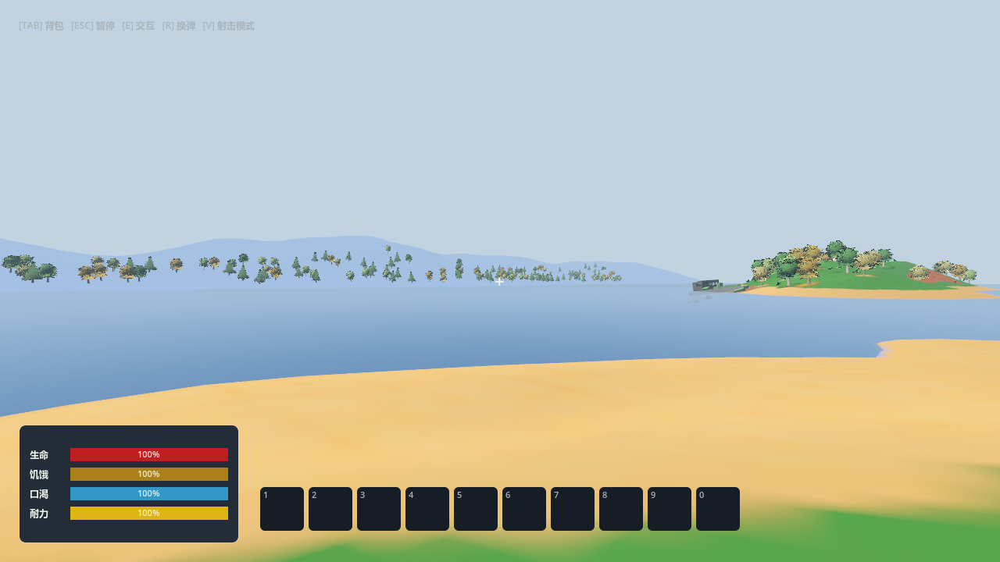
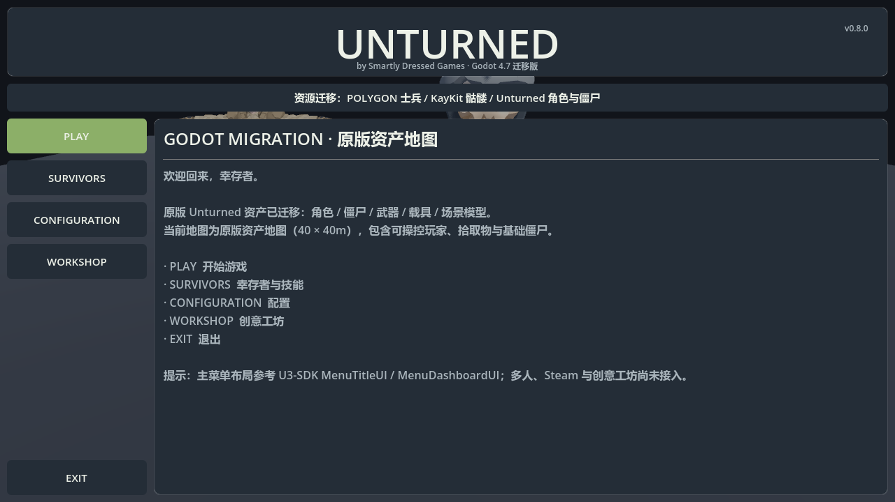
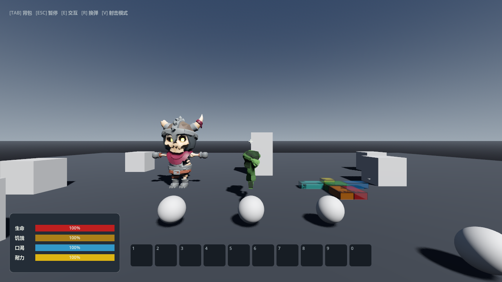
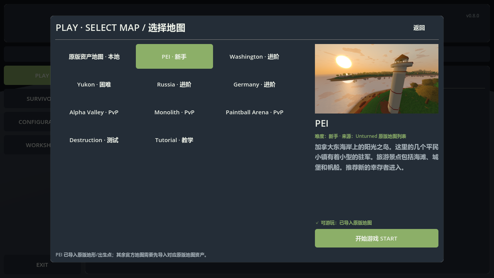
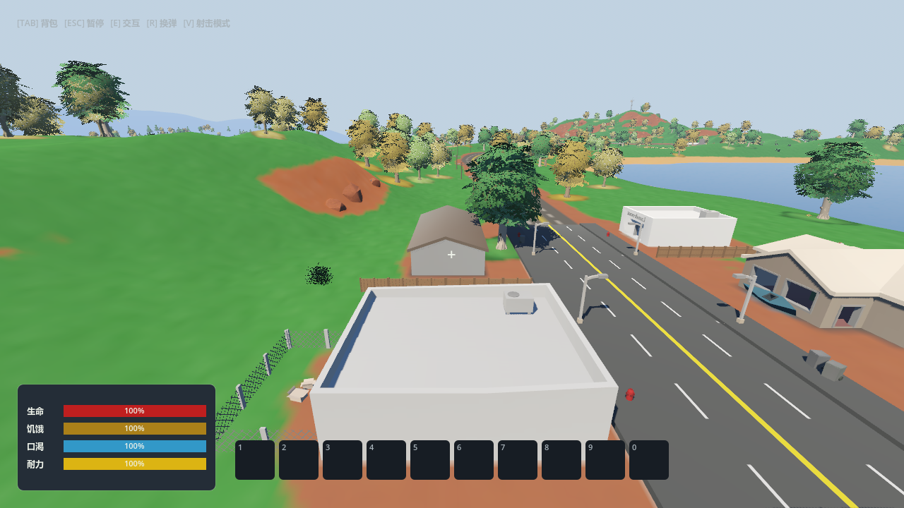

# UnturnedGodot — 资源迁移验证项目

把 **Unturned 源码资产** + **POLYGON Military** + **KayKit** 迁到 Godot 4.7 的可运行工程。

> 定位：**资源迁移 + 玩法重写**，不是「Unturned 移植」。
> U3-SDK 有 43 万行 C#，没有工具能自动转 Godot，逻辑部分必须重写。

---

## 快速开始

```bash
# 打开编辑器
D:\Godot\Godot_v4.7.2-stable_win64.exe --path D:\Rust2\UnturnedGodot

# 直接运行（默认主场景 main_menu.tscn：主页面 → PLAY → 选择地图）
D:\Godot\Godot_v4.7.2-stable_win64.exe --path D:\Rust2\UnturnedGodot

# 直接打开本地原版资产地图（跳过主菜单）
D:\Godot\Godot_v4.7.2-stable_win64.exe --path D:\Rust2\UnturnedGodot res://scenes/main.tscn

# 直接打开 PEI 原版地图（读取 Unturned 高度图/出生点）
D:\Godot\Godot_v4.7.2-stable_win64.exe --path D:\Rust2\UnturnedGodot res://scenes/maps/pei.tscn

# 运行已导出的 Windows EXE（单文件，无 Console）
D:\Rust2\UnturnedGodot\build\UnturnedGodot.exe

# 资源完整性自检
D:\Godot\Godot_v4.7.2-stable_win64.exe --headless --path D:\Rust2\UnturnedGodot --script res://verify_assets.gd
```

---

## 主页面 / 选择地图

- `scenes/main_menu.tscn` + `scripts/ui/main_menu.gd`：按 U3-SDK `MenuTitleUI` / `MenuDashboardUI` 还原的主页面：顶部标题栏（UNTURNED + 作者/版本）、可点击统计条、左侧 PLAY / SURVIVORS / CONFIGURATION / WORKSHOP / EXIT 按钮、右侧迁移信息面板与子页面弹层；PLAY 打开地图选择页，ESC 关闭子页面。
- `scenes/main.tscn`：可玩的“原版资产地图”，保留 POLYGON 士兵/骷髅、KayKit 战士、Unturned Human/Zombie 等原始迁移资产，并放置可操控 Player、HUD、拾取物、箱体掩体与地面碰撞；不再自动截图退出。
- **已删除 `scenes/survival_test.tscn` 测试地图**及其启动/导出引用；玩法测试仍在 `test_*.gd` 中，不再作为游戏入口。
- **PLAY → 选择地图**：按 U3 MenuPlayUI 风格显示官方地图列表（PEI / Washington / Yukon / Russia / Germany / Alpha Valley / Monolith / Paintball Arena / Destruction / Tutorial，描述来自 Unturned 本地化），选中后显示难度、描述、原版 Preview 图和可用状态。**PEI 已可进入**（原版高度图/地形/出生点/卫星图）；`原版资产地图` 本地地图可进入；其余官方地图仍标记为缺少地图资产。
- **PEI 原版地图已导入**：读取 `Maps/PEI/Landscape/Heightmaps/*.heightmap`、`Spawns/Players.dat`、`Map.png`，运行时生成地形网格 + `HeightMapShape3D` 碰撞 + 海水 + 原版出生点；详见下一节。
- 其他官方地图仍可继续用同一套流程导入（Washington / Yukon / Russia / Germany 等）；PEI 已接入地形、对象、树木与实际 prefab Hitbox。









---

## PEI 原版地图导入

PEI 已从本机完整安装的 Unturned 中提取并接入：

- **原始数据**：`E:\Steam\steamapps\common\Unturned\Maps\PEI`
  - `Landscape/Heightmaps/Tile_x_y_Source.heightmap`：16 个 257×257 大端 `uint16` 瓦片
  - `Spawns/Players.dat`：22 个原版玩家出生点
  - `Map.png`（卫星底图）/ `Preview.png`（菜单预览图）
- **工程数据**：`data/maps/PEI/`
  - `height.bin`：预处理后的 1025×1025 `float32` 高度场（世界 X/Z 网格，4m 单位）
  - `spawns.json`、`meta.json`、`map.png`、`preview.png`
- **运行时**：`scripts/maps/pei_map.gd`
  - 世界高度 = `-1024 + height01 × 2048`，海平面 `25.6`
  - 全图 4096m 地形（8m 步长，`HeightMapShape3D` 碰撞）；`Map.png` 只覆盖 CartographyVolume 区域（X `-966..956`、Z `-954..971`），区域外采样边缘颜色，避免地图外树木悬空
  - `HeightMapShape3D` 地形碰撞、海水平面、天空/太阳/雾
  - 默认出生点使用原版 `Players.dat` 第 6 个点（西海岸开阔出生点）
- **启动方式**：
  - 主菜单 PLAY → 选择地图 → PEI
  - `--map=pei` 命令行直接进入（用于验证导出 EXE）
  - 编辑器直接运行 `res://scenes/maps/pei.tscn`

当前已导入：

- **地形 + 卫星贴图 + 出生点**
- **对象层（UV + 贴图 + 朝向修正）**：解析 `Level/Objects.dat` 的 4329 个对象摆放，匹配 `Bundles/Objects/**/*.dat`；用 UnityPy 从 `core.masterbundle` 提取 PEI 实际使用的 **338 个 prefab（LOD0）**，导出 **496 个带 UV/材质的 surface + 220 张贴图**，并以 `MultiMesh` 实例化 **4077 个对象**（房屋/围栏/岩石/路牌/道具/车辆等）。
- **朝向修复**：Unturned `LevelObject` 实例化时用地图 placement 覆盖 prefab 根 transform，因此导出时**跳过 prefab 根 position/rotation/scale**，只应用子节点变换；否则会把根变换叠加两次，出现道路竖立、建筑错位。
- **植被**：解析 `Terrain/Trees.dat`（1694 条记录），导出 **68 个树木 prefab（65 张贴图）**，实例化 **1693 棵树**。
- **Hitbox（实际 prefab 碰撞体）**：解析 prefab 的 `MeshCollider` / `BoxCollider` / `CapsuleCollider`，按子节点变换烘焙到对象本地空间，导出 `data/maps/PEI/colliders.json`；运行时共享 mesh/shape 资源并生成 **7499 个 CollisionShape3D**（`PEI_ObjectCollision`）。帐篷使用帐篷网格碰撞（内部可进入）、桥梁使用桥面网格（可上桥/桥下可通行）、树木使用树干 `CapsuleCollider`（树荫下可走）。
- 仍未导入：LOD1+、草/地表 foliage、独立道路网格、精确对象碰撞体；部分 prefab 的贴图是 palette/低分辨率贴图。



后续：碰撞体性能优化/触发器细化、草/地表植被、道路网格、LOD1+、其他官方地图；接入方式与其他地图一致。

---

## 应用图标（SVG → ICO）

应用图标使用 SVG 绘制，再栅格化为 Windows ICO，已应用到 EXE：


- `icon.svg`：512 × 512 矢量源文件（军事绿圆角徽章 + 瞄准环 + 粗体 U 字 + 准星刻度 + 红色警戒点）
- `icon.png`：256 × 256，用作 Godot 项目/窗口图标（`project.godot` 的 `config/icon`）
- `icon.ico`：多尺寸 16 / 24 / 32 / 48 / 64 / 128 / 256，用作 Windows EXE 文件图标（`export_presets.cfg` 的 `application/icon`，并开启 `application/modify_resources`）
- EXE 同时写入了版本信息：`FileVersion 0.8.0.0`、`ProductVersion 0.8.0`、`ProductName/CompanyName UnturnedGodot`

修改图标时：编辑 `icon.svg` → 重新导入生成 `icon.png` / 多尺寸 PNG → 用 Pillow 合成多尺寸 `icon.ico` → 重新导出 EXE。

验证：从 EXE 提取到的 32×32 关联图标与图标源一致，版本信息显示 `0.8.0.0`。

---

## 导出 Windows EXE

工程已包含 [export_presets.cfg](export_presets.cfg)（Windows Desktop / x86_64 / 单文件嵌入 PCK，排除测试脚本），并已构建：

- **`build/UnturnedGodot.exe`**（release，约 139 MB，无需额外 `.pck`，双击即可运行）
- 启动流程：主页面（`main_menu.tscn`）→ PLAY → 选择地图 → PEI 原版地图（`scenes/maps/pei.tscn`）或本地原版资产地图（`main.tscn`）
- 导出时依赖 `%APPDATA%\Godot\export_templates\4.7.2.stable\windows_release_x86_64.exe`

重新导出：

```bash
# 修改脚本/资源后先重新导入
D:\Godot\Godot_v4.7.2-stable_win64.exe --headless --path D:\Rust2\UnturnedGodot --import

# 单文件 Windows release exe
D:\Godot\Godot_v4.7.2-stable_win64.exe --headless --path D:\Rust2\UnturnedGodot --export-release "Windows Desktop" build\UnturnedGodot.exe
```

说明：

- `exclude_filter` 已排除 `test_*.gd`、`verify_assets.gd`，EXE 内不含迁移测试脚本。
- 如需 Console 版日志窗口，把 `debug/export_console_wrapper` 改为 `1` 后重新导出（会额外生成 console wrapper）。
- 当前 EXE 为本地单机构建：无 Steam/ENet 联机、无服务器权威校验；U3-SDK 资产/代码的 Mod 分发限制仍适用（见文末许可说明）。
- 本机 headless 运行 EXE 时可能打印 `user://logs`/证书库读取失败，这是运行环境限制；不影响游戏启动与场景加载（已验证能加载 `main_menu.tscn` 并进入地图）。

```
UnturnedGodot/
├── export_presets.cfg          # Windows Desktop 导出预设
├── build/
│   └── UnturnedGodot.exe       # 已导出的单文件 EXE
```

## 项目结构

```
UnturnedGodot/
├── project.godot
├── verify_assets.gd            # 资源自检脚本（统计网格/骨骼/动画）
├── screenshot_main.png         # 主页面背景截图（由展示场景渲染生成）
├── scenes/
│   ├── main_menu.tscn          # 主页面：开始游戏 / 操作说明 / 退出
│   ├── main.tscn               # 可玩原版资产地图：Player + HUD + 拾取物 + 原版模型
│   ├── maps/pei.tscn           # PEI 原版地形地图场景
│   └── level_test_crate.tscn   # 箱体道具（原版资产地图用地）
├── scripts/
│   ├── screenshot.gd           # 渲染 N 帧后截图并退出的工具脚本
│   ├── maps/pei_map.gd         # PEI 高度图 → 地形/碰撞/海水/出生点
│   └── character_picker.gd     # POLYGON 角色选择器（23 选 1）
├── data/maps/PEI/              # PEI 原版地图数据（height.bin / map.png / spawns）
└── assets/
    ├── polygon/                # POLYGON Military（Synty）
    │   ├── POLYGON_Characters.glb   # 23 角色 + 10 附件，50 骨骼，已内嵌图集
    │   └── PolygonMilitary_Texture_*.png
    ├── unturned/               # U3-SDK 资产
    │   ├── models/             # UT_Human / UT_Zombie / UT_Human_Mega / UT_Ragdoll / UT_Viewmodel
    │   └── animations/         # 6 个 GLB，含 75 段动画
    └── kaykit/                 # KayKit Skeletons（CC0）
        ├── Skeleton_Warrior/Rogue/Mage/Minion.glb   # 各 41 骨骼、95 段动画
        └── Skeleton_*.gltf     # 13 件武器
```

---

## 已验证的资源数据

自检脚本实测输出（`verify_assets.gd`）：

| 资源 | 网格 | 骨骼 | 动画 |
|---|---|---|---|
| `POLYGON_Characters.glb` | 33 | 1 骨架 / 50 根 | 1（空 Take） |
| `UT_Human.glb` | 1 | 16 根 | — |
| `UT_Viewmodel.glb` | 1 | 16 根 | — |
| `UT_Zombie.glb` | 1 | 0 | — |
| `UT_Human_Basic_Move.glb` | — | — | **7 段**（Climb/Crouch/Prone/Run/Swim/Walk） |
| `UT_Human_Basic_Idle.glb` | — | — | **11 段**（Bicycle/Climb/Crouch/Drive/Prone/Reclined/Sit/Swim/Zip…） |
| `UT_Zombie_Basic.glb` | — | — | **44 段**（Attack 0-8 / Stun 0-11 / Startle 0-6 / Acid / Fire / Electric / Wind…） |
| `Skeleton_Warrior.glb` | 10 | 41 根 | **95 段** |
| `Skeleton_Rogue.glb` | 10 | 41 根 | **95 段** |
| `Skeleton_Mage.glb` | 9 | 41 根 | **95 段** |
| `Skeleton_Minion.glb` | 9 | 41 根 | **95 段** |

**合计 11/11 全部加载成功。**

---

## 转换流程（已跑通的管线）

### 1. 解包 unitypackage

`.unitypackage` 本质是 gzip tar，每个资源一个 GUID 目录：

```
<guid>/pathname   → 目标相对路径（末尾带 \n00 标记，必须截断）
<guid>/asset      → 原始文件字节
<guid>/asset.meta → Unity 导入设置 YAML
```

```bash
python _tools/extract_unitypackage.py \
  "E:/BaiduNetdiskDownload/POLYGON Military - ... .unitypackage" \
  _extracted/polygon fbx,png,tga
# → 1629 个 FBX + 95 张贴图
```

### 2. FBX → GLB

```bash
FBX2glTF.exe --binary -i Characters.fbx -o out/POLYGON_Characters
```

### 3. 嵌入丢失的贴图

FBX2glTF 找不到 Synty 引用的 Unity 内部纹理（`file1198`），模型会变纯色。
先确认正确图集（从 prefab → material → texture 反推）：

```
SM_Chr_Soldier_Male_01.prefab
  → PolygonMilitary_Mat_01_A.mat
    → PolygonMilitary_Texture_01_A.png  ← 角色图集
```

```bash
python _tools/embed_glb_texture.py in.glb atlas_2048.png out.glb
```

**注意**：4096×4096 图集会触发 Godot 的 WebP 压缩失败（`WebP packing failed`），
必须降到 **2048×2048** 再嵌入。

### 4. Godot 导入

```bash
Godot --headless --path . --import
```

---

## Unidot Importer（已安装）

把 `.unitypackage` / Unity 资产文件夹翻译成 Godot 原生资源（`.tscn` / `.tres`）。

### 当前状态

| 项 | 状态 |
|---|---|
| 插件位置 | `addons/unidot_importer/`（V-Sekai/unidot_importer，已 clone） |
| 启用 | ✅ `project.godot` 的 `[editor_plugins]` 已加入 |
| 4.7 兼容性 | ✅ 5 个核心脚本 `--check-only` 全部 0 错误 |
| FBX 依赖 | ✅ **不需要 FBX2glTF**——Godot 4.7 原生支持 FBX |
| 自动化 | ❌ 跑不了，见下 |

### 关键发现：Godot 4.7 原生支持 FBX

```
FBXDocument: true
FBXState:    true
Godot: 4.7.2-stable
```

Unidot 内部判断 `builtin_ufbx_supported = ClassDB.class_exists("FBXDocument")`，
在 4.7 上为 **true**，所以它会走内置 ufbx 路径，**不需要配置 FBX2glTF**。
实测把 `UT_Zombie.fbx` 直接丢进项目，`--import` 一次通过，生成正常 `.import`。

### 为什么不能自动化

Unidot 的导入是 **GUI 状态机**：`package_import_dialog.gd` 依赖 `Tree` 节点的
checkbox 状态、`Timer` 驱动的 `do_import_step()` 循环、以及 `EditorPlugin` 实例。
`--script` 模式要求脚本继承 `SceneTree`，`EditorScript` 跑不了；headless 下
`TreeItem` 的选中状态无法构造。**必须手动点 3 下。**

### 操作步骤（3 步）

1. 打开编辑器
   ```
   D:\Godot\Godot_v4.7.2-stable_win64.exe --path D:\Rust2\UnturnedGodot --editor
   ```
2. 菜单 **项目 → 工具 → Import .unitypackage...**
   （英文界面：**Project → Tools → Import .unitypackage...**）
3. 选文件，全选资产，点 **Start Import**

**导入 POLYGON Military**：
```
E:\BaiduNetdiskDownload\POLYGON Military - Low Poly 3D Art by Synty v1.02.unitypackage
```

**导入 Unturned 源码资产**（选文件夹，不是包）：
```
D:\Rust2\_research\U3-SDK\Assets
```
> 注意：U3-SDK 有 1957 个 C# 脚本，Unidot **不支持 MonoBehaviour**，脚本会被跳过。
> 场景/预制体/材质/动画能转，逻辑代码不会。

### Unidot 能力边界

**支持**：Mesh / SkinnedMeshRenderer / Material（仅 Standard Shader）/ Avatar /
AnimationClip / **AnimatorController**（转 AnimationTree）/ AnimatorState / BlendTree /
PrefabInstance / GameObject / Transform / Collider / Rigidbody / Light / Camera /
Texture2D / AudioClip / **Terrain**（有限）/ LightingSettings

**不支持**：Shader（需手工）、**MonoBehaviour（C# 脚本）**、AvatarMask、Canvas/UI、
PlayableDirector

> 这正是「资源迁移 + 玩法重写」判断的又一个佐证：连专业工具都只转资产，不转逻辑。

### 已知风险

- Unidot 官方只测到 **Godot 4.0–4.2**，4.7 虽然语法通过，但运行时行为未验证
- 需要 **16 GB 内存**，大包导入峰值可达 10–12 GB
- 缺 UpperChest / Shoulder / Neck 骨骼的模型，人形重定向可能出错
- 导入后再 reimport 动画可能丢失 track 路径

---

## 角色选择器用法

`Characters.fbx` 把 23 个角色 + 10 个附件塞在同一个骨架下，默认全部重叠。
`character_picker.gd` 按名字只显示一个：

```gdscript
# scenes/main.tscn 里 CharacterSlot 节点上
visible_character = "SM_Chr_Soldier_Male_01"
show_attachments = false
```

可选角色（23 个）：
```
SM_Chr_Bombsuit_Male_01        SM_Chr_Insurgent_Female_01/02
SM_Chr_Civilian_Female_01/02   SM_Chr_Insurgent_Male_01~05
SM_Chr_Civilian_Male_01/02     SM_Chr_Leader_Male_01
SM_Chr_Contractor_Female_01    SM_Chr_Pilot_Female_01 / Male_01
SM_Chr_Contractor_Male_01/02   SM_Chr_Soldier_Female_01/02
SM_Chr_Ghillie_Male_01         SM_Chr_Soldier_Male_01/02
```

---

## 已知问题

| # | 问题 | 原因 | 状态 |
|---|---|---|---|
| 1 | Unturned 模型散架（渲染成一堆彩色方块） | FBX 单位是 cm：网格节点 scale=100，但骨骼节点 scale=1，蒙皮矩阵不匹配 | **未修**。不影响 POLYGON 主线；UT 模型本来就与 POLYGON 风格不搭 |
| 2 | POLYGON 图集 4096 导入报 WebP 错误 | Godot 对超大嵌入纹理压缩失败 | **已修**：降到 2048 |
| 3 | Quaternius 动画未下载 | `quaternius.itch.io` 在本机不通（000），官网下载按钮全部指向 itch.io | **待办**：需手动下载或代理 |
| 4 | 动画重定向未验证 | POLYGON 50 骨骼 vs KayKit 41 骨骼，命名不同 | **待办**：需建 `SkeletonProfileHumanoid` + BoneMap |

---

## 素材来源与许可

| 素材 | 来源 | 许可 | 约束 |
|---|---|---|---|
| POLYGON Military | Synty（主人自有） | Synty 标准许可 | 可商用，**不得转售原始资源** |
| U3-SDK 资产 | Smartly Dressed Games | U3 SDK License | **严格非商业**、仅 PC、**禁用 UNTURNED 商标** |
| KayKit Skeletons | Kay Lousberg | **CC0** | 无限制 |

全部素材**不含 GPL / AGPL / LGPL**。

### U3-SDK 关键条款（务必遵守）

- 只能免费、非商业分发
- 只能跑 Windows / macOS / Linux PC
- 禁止主机、移动、云游戏串流
- 不得使用 UNTURNED 商标，只能声明「基于该软件」
- 分发时须附带版权声明 + 许可协议 + `THIRDPARTYNOTICES.txt`

---

## 下一步

1. **修 Unturned 模型单位**（若要保留方块风）：后处理 GLB，把 POSITION ×100 并重置节点 scale
2. **下载 Quaternius UAL**（CC0，120+ 人形动画）：需手动访问 itch.io
3. **建动画重定向**：`SkeletonProfileHumanoid` + BoneMap，把 KayKit/Quaternius 动画套到 POLYGON 角色
4. **僵尸方案**：POLYGON 的 `SM_Chr_Civilian_*` 改材质（去饱和、偏绿、加破损）+ 复用同一骨架
5. **玩法重写**：参考 U3-SDK 的 `Inventory` / `Interactable` / `Zombies` 模块设计，用 GDScript 重写

---

## 工具链

| 工具 | 路径 | 用途 |
|---|---|---|
| FBX2glTF 0.9.7 | `D:\Rust2\_tools\FBX2glTF.exe` | FBX → GLB |
| extract_unitypackage.py | `D:\Rust2\_tools\` | 解包 unitypackage |
| embed_glb_texture.py | `D:\Rust2\_tools\` | 把贴图嵌入 GLB |
| Godot 4.7.2 | `D:\Godot\Godot_v4.7.2-stable_win64.exe` | 引擎 |

### 网络备忘

GitHub 直连不通（git 全局代理指向不通的 `127.0.0.1:2289`）。可用通道：

```bash
git -c http.proxy= -c https.proxy= clone --depth 1 https://ghfast.top/https://github.com/<owner>/<repo>.git
```

备选镜像：`ghproxy.net` / `gitclone.com`
## POLYGON 僵尸改模与动画重定向

- `scripts/polygon_zombie_retarget.gd`：将 `UT_Zombie_Basic.glb` 的 17 骨骼动画按语义映射到 POLYGON 50 骨骼。
- `scenes/main.tscn`：可玩原版资产地图；`ZombiePreview` 使用 `SM_Chr_Civilian_Male_01` 僵尸材质变体并播放 `Idle_0`。
- 可调用 `play_zombie_animation("Attack_0")`、`Move_0`、`Stun_0` 等 U3 动画。
- 原始 GLB 未修改；僵尸材质通过运行时副本着色，避免破坏原始 POLYGON 资源。

## GDScript 玩法模块（迁移阶段）

已按 U3-SDK 的单机玩法边界重写基础模块：

- `scripts/player_controller.gd`：第一人称 WASD、鼠标视角、冲刺、跳跃、E 键交互。
- `scripts/player_life.gd`：生命、饥饿、口渴、持续消耗、伤害、治疗和死亡信号。
- `scripts/inventory.gd` + `scripts/item_definition.gd`：物品定义、堆叠、重量/格数限制、拾取、消耗品。
- `scripts/interactable.gd` + `scripts/pickup_interactable.gd`：交互基类和背包拾取物。
- `scripts/polygon_zombie_retarget.gd`：POLYGON 僵尸动画重定向与基础追击/攻击/受伤状态。
- `scenes/main.tscn`：可玩原版资产地图（主菜单“开始游戏”入口）；WASD 移动、Shift 冲刺、Space 跳跃、鼠标转向、E 拾取。旧 `survival_test.tscn` 测试地图已删除。
- `test_gameplay.gd`：无头测试背包堆叠、重量、移除、治疗、拾取与死亡状态。`test_bundles_level.gd`：无头测试资产数组加载、索引、出生表、关卡摆放及清理。

### Bundles / Level 当前迁移范围

- `scripts/bundles/`：Godot `Resource` 资产基类、物品/场景对象/加权出生表资产，含 ID/GUID/类型索引、重复项检查、JSON 单对象/数组解析与目录扫描。
- `scripts/level/`：关卡基础配置、对象摆放（位置/旋转/缩放/区域）、玩家/僵尸出生数据；`LevelRuntime` 可实例化关卡场景、对象与出生标记，并按区域查询。
- `data/assets/migration_examples.json`：四类 JSON 迁移样例；`test_bundles_level.gd` 覆盖批量解析、查找、出生表抽取、对象摆放和清理。
- 这属于核心运行时数据与摆放流程的重写，并非 U3 `Bundles`（236 个 C# 文件）和 `Level`（106 个 C# 文件）的逐文件翻译。尚未迁移的主要内容包括 Unity AssetBundle/Addressables 与异步依赖加载、原生地图对象/道路/导航、区域体积与专用出生系统（PEI 高度图地形/出生点已接入，见“PEI 原版地图导入”）、关卡编辑器/序列化兼容、网络同步，以及大量具体物品和对象子类。
- 验证命令：`D:\Godot\Godot_v4.7.2-stable_win64.exe --headless --path . --script res://test_bundles_level.gd`。
这不是 1957 个 C# 文件的自动翻译；联网、Steam、编辑器工具和 U3 特有服务仍未迁移。U3-SDK 条款对基于其代码/资产的 Mod 有平台与非商业限制，发布时需一并遵守其 LICENSE 与 THIRDPARTYNOTICES。

---

## UI / Sleek 迁移（C# → GDScript）

U3 源目录包含 `UI/` 86 个与 `Sleek/` 62 个 C# 文件。本实现提供 Godot 原生 UI 框架和单机生存 HUD 子集，并非 148 个文件的逐文件等价翻译。

把 U3-SDK 的 Glazier/Sleek UI 层迁成 Godot `Control` 控件，并把库存格从 HUD 里抽成**可复用的 Sleek 控件**。

### 分层

```
scripts/sleek/   Sleek 控件库（不依赖任何玩法类，可复用于背包/箱子/商店/战利品）
  sleek_theme.gd        SleekCustomization + Palette + 品质色
  sleek_layout.gd       ISleekElement 坐标契约：pos = parent*scale + offset
  sleek.gd              Glazier.Get().Create*() 工厂
  sleek_label / box / panel / image / button / progress / scroll_box / list /
  toggle / slider / field / window
  sleek_item_stack.gd   与玩法无关的物品 DTO
  sleek_inventory_model.gd  数据源抽象（signal changed + get_stack）
  sleek_slot.gd         可复用库存格（图标/数量/品质/热键/选中/装备态）
  sleek_inventory.gd    可复用库存网格（SleekInventory，可任意列数/格数）
  sleek_hotbar.gd       复用同一网格的 10 格快捷栏（SleekHotbar）

scripts/ui/      界面与适配层
  ui_screen.gd          全屏 Screen 基类（open/close 状态机）
  ui_manager.gd         单活动 Screen 管理（PlayerUI + PlayerDashboardUI 的页面调度）
  player_inventory_model.gd  PlayerInventory → SleekInventoryModel 适配器
  player_hud.gd         PlayerLifeUI 子集：生命/饥饿/口渴、准星、快捷栏、交互提示
  inventory_screen.gd   PlayerDashboardInventoryUI 子集：格位墙 + 容量/重量 + 物品详情
  pause_screen.gd       PlayerPauseUI 子集
  death_screen.gd       PlayerDeathUI 子集
  game_hud.gd           组合根：SleekWindow + Screen 注册 + 输入/光标，不含背包布局与物品逻辑
```

### 复用库存格的用法

```gdscript
# 任意数据源：实现 SleekInventoryModel 即可（玩家背包只是其中一种）
var model := SleekInventoryModel.new(24)
model.set_stack(0, SleekItemStack.new(&"bandage", "绷带", 3))

# 同一个控件可以放在背包页、箱子页、商店页……
var grid := SleekInventory.new()
grid.columns = 6
add_child(grid)
grid.bind_model(model)
grid.slot_activated.connect(_on_slot_activated)   # 点击有物品的格位

# 快捷栏不复制一套逻辑，直接复用网格
var hotbar := SleekHotbar.new()                    # columns=10, 显示 1..0 热键
add_child(hotbar)
hotbar.bind_model(model)
```

玩家背包通过 `PlayerInventoryModel` 适配：

```gdscript
var model := PlayerInventoryModel.new(player_inventory)
inventory_screen.bind_model(model)   # InventoryScreen 只认 SleekInventoryModel
```

### 解耦约束（由测试守护）

- `scripts/sleek/*` 不允许出现 `PlayerInventory` / `ItemDefinition` / `PlayerLife`，控件只吃 `SleekItemStack` / `SleekInventoryModel`。
- HUD 不构造 `SleekSlot`、不搭 `GridContainer`；背包布局全部在 `InventoryScreen`。
- 新增容器界面（箱子/战利品/商店）只需实现一个 Model 适配器 + 注册一个 Screen，不用改 HUD。

### C# 来源对照（迁移子集）

| C# | GDScript |
|---|---|
| `SDG.Glazier/Sleek.cs`（ISleekElement 坐标契约） | `scripts/sleek/sleek_layout.gd` |
| `SDG.Glazier/Glazier.cs`（Create* 工厂） | `scripts/sleek/sleek.gd` |
| `SDG.Glazier/SleekLabel.cs` / `SleekBox.cs` / `SleekImageTexture.cs` | `sleek_label.gd` / `sleek_box.gd` / `sleek_image.gd` |
| `SDG.Glazier/SleekButton.cs` | `sleek_button.gd` |
| `SDG.Glazier/SleekScrollBox.cs` / `SleekToggle.cs` / `SleekSlider.cs` / `SleekField.cs` | `sleek_scroll_box.gd` / `sleek_toggle.gd` / `sleek_slider.gd` / `sleek_field.gd` |
| `Unturned/Sleek/SleekProgress.cs`（state/roundingMode/suffix/measure/color） | `sleek_progress.gd` |
| `Unturned/Sleek/SleekList.cs` | `sleek_list.gd` |
| `Unturned/Sleek/SleekSlot.cs` + `SleekHotbarEntry.cs` | `sleek_slot.gd` |
| `Unturned/UI/Player/PlayerDashboardInventoryUI.cs`（格位墙） | `sleek_inventory.gd` + `scripts/ui/inventory_screen.gd` |
| `Unturned/Player/PlayerUI.cs` + `PlayerLifeUI.cs` | `scripts/ui/game_hud.gd` + `player_hud.gd` |
| `Unturned/UI/Player/PlayerDashboardUI.cs` | `scripts/ui/ui_manager.gd`（页面注册/切换） |
| `Unturned/UI/Player/PlayerPauseUI.cs` / `PlayerDeathUI.cs` | `pause_screen.gd` / `death_screen.gd` |

### 未迁移 / 已知差异

UI 源码总量还包括完整主菜单、服务器浏览/联机、大量角色/服装/工作坊页面，以及关卡编辑器 UI；这些依赖 Steam、Unity 编辑器、网络服务或尚未迁移的游戏系统，目前仅标为未迁移，不提供空壳实现。

- 没有逐文件翻译 60+ 个 `Sleek*` 控件；只迁移了单机玩法 HUD 用到的子集（不含 WebImage / 颜色选择器 / 商店条目 / 服务器列表等）。
- `PlayerDashboardUI` 的合成/技能/信息三个标签页未迁移，背包页以独立 `InventoryScreen` 呈现。
- 未迁移拖放换位、分页、物品上下文菜单、聊天/投票/指南针、RichText 对比度上下文（uGUI 专属）。快捷栏装备：选择热键栏会同步 `PlayerInventory.active_slot` 并调用 `PlayerEquipment`，SleekSlot 显示已装备高亮。
- `SleekProgress` 用 `ColorRect` 实现（C# 用 1×1 像素贴图），百分比/`suffix`/`measure`/取整模式与 C# 一致。
- 光标锁定由 `GameHUD` 用 `Input.mouse_mode` 管理（C# 在 `SleekWindow`），headless 下自动跳过。
- `scripts/sleek` 与 `scripts/ui` 的全局类已写入 `.godot/global_script_class_cache.cfg`；重新 `--import` 会被 Godot 覆盖重写，属正常现象。

### 验证命令

```bash
# 新增/重命名脚本后先让 Godot 重新扫描全局类
D:\Godot\Godot_v4.7.2-stable_win64.exe --headless --path D:\Rust2\UnturnedGodot --import

# Sleek/UI 无头测试：控件迁移、网格复用、解耦约束、HUD/背包/暂停/死亡/重生
D:\Godot\Godot_v4.7.2-stable_win64.exe --headless --path D:\Rust2\UnturnedGodot --script res://test_ui.gd
```
## Interactable 迁移（核心单机子集）

U3 `Interactable/` 目录有 55 个 C# 文件，涵盖世界对象交互、载具/车轮/乘客、引擎音效、物理浮力、网络状态和服务端逻辑。Godot 侧实现原生交互契约与常用单机类型：

- `scripts/interactable.gd`：交互可用性、焦点进出事件、提示/高亮信息、单次交互、状态导入导出。
- `scripts/pickup_interactable.gd`：支持部分拾取/剩余数量、背包满提示与状态恢复。
- `scripts/interactable/`：门、储物容器、发电机、采集物、梯子、二态开关、所有权/拆除计时基础。
- `scripts/player_controller.gd`：射线焦点只选择有效对象，正确触发焦点生命周期；E 键调用交互。
- `scripts/ui/game_hud.gd`：显示目标对象提供的交互提示及颜色。
- `test_interactable.gd`：覆盖可用性、单次交互、部分拾取、锁门、储物序列化、发电、采集、梯子与所有权规则。

未逐文件实现的 55 个源文件中，主要缺口是 U3 网络/服务器权威与 NetId、Unity 动画/音频/碰撞组件适配，以及整套车辆驾驶/乘客/车轮/引擎系统、NPC/任务/对话、Steam/工作坊和专有资产状态。`InteractableSalvageable` 仅提供本地所有权校验与拆除生命周期，不代替 U3 的多人授权协议。新增 `InteractableDialogue` 与 `InteractableNote`，通过信号对接游戏侧对话/便笺 UI，并提供本地条件门控；它们不包含 U3 的网络请求、服务器条件验证或任务服务。


### Vehicle and U3 service port

The Godot vehicle runtime is implemented in `scripts/vehicles/`: `VehicleController` uses `VehicleBody3D` for driving, seat occupancy, lock ownership, health/damage, fuel, battery, lights, trunk stacks, and serializable runtime state. `VehicleBuoyancy` applies buoyancy forces at configured float points; `VehicleBumper` maps collisions to damage. Compose these scripts with wheel nodes, seat markers, collision shapes, lights, and a vehicle visual scene. This is a Godot-native feature port, not a line-by-line rewrite of U3's 5,498-line `InteractableVehicle.cs`; specialized aircraft, turrets, crawler tracks, vehicle asset parsing, wheel damage/effects, and Unity material/audio hooks still require per-asset adapters.

`GameServices` (`scripts/services/u3_service_gateway.gd`) exposes correlated request/response ports for identity, authority, persistence, dialogue, quest, workshop, transport, and economy. Dialogue and note interactions dispatch through these ports as well as local signals. The gateway intentionally includes no Steam, ENet, server, workshop, or economy implementation: production adapters must provide those integrations and must validate authority server-side. Until an authority adapter is connected, the vehicle runtime is local/offline and must not be treated as multiplayer-secure.

## Player / Managers / Utils / Edit / Tools 迁移（核心子集）

- `scripts/player/`：技能经验与升级、任务/旗标/追踪、本地小队成员与等级、站姿状态；`PlayerLife` 增加耐力、病毒、流血、骨折、温度和状态存取，`PlayerController` 支持冲刺消耗耐力、蹲伏/卧倒移动速度及上下车输入。
- `scripts/managers/`：可注册状态提供者的 JSON 存档管理、弱引用网格区域空间索引、输入重绑定。
- `scripts/utils/`：序列解析/IP 验证、RK4 弹簧、Transform 插值/旋转和递归节点查找。
- `scripts/edit/`：基于 NodePath 的变换撤销/重做栈；`scripts/tools/`：PackedScene 对象池、射线与球体空间查询。

这些实现是迁移后的可复用单机基础设施，并非 U3 目录逐文件翻译。U3 Managers 中的 Steam/ENet 权威同步、专用服务器、各类区域/资产管理和 Unity 场景生命周期未实现；Player 的多人输入协议、完整动画/音频事件路由与 U3 内置技能枚举表仍未等价实现（装备/衣物/动画/语音的本地运行时接线与技能/任务资产兼容见下一节）；Utils 中依赖 Steam、Unity Editor、TMP、平台原生代码的工具未移植；Edit 中 Unity Editor UI 和 Reun/工作区系统未实现（地形/道路/刷怪编辑器已有 Godot 原生实现，见下一节）；Tools 中各游戏对象专用工具、Unity 预览捕获和工作坊工具未移植。Godot 侧应使用对应原生节点/编辑器插件继续实现这些能力，服务端权限必须由真实 authority adapter 验证。

## Inventory / Useable / Damage / Crafting 迁移（核心单机子集）

- `scripts/inventory.gd`：支持可堆叠物品、重量与格位约束、堆叠拆分/交换、快捷栏索引、状态存取及使用流程。
- `scripts/useable/`：实现消耗品、近战射线攻击与可配置投射物使用；`scripts/player_life.gd` 支持生命、食物、水、病毒和耐力物品效果。
- `scripts/inventory/`：配方校验、材料/技能要求、重复制作、产物容量预检、失败回滚及经验奖励。
- `scripts/damage/`、`scripts/throwables/`：本地伤害上下文、护甲/无敌/死亡处理，以及寿命、碰撞和范围伤害投射物。
- `test_gameplay.gd` 验证背包堆叠、重量、消耗品使用、拾取与死亡状态。

这不是 U3 `Useable/` 的逐文件完整移植：枪械、附件、弹道/后坐力、动画音频、服务器端命中校验和多人网络授权仍未实现。投射物和伤害目前为本地单机逻辑；联机使用前必须接入权威服务器验证。U3 `Inventory/` 中的装备栏、服装/皮肤、交易/插件和完整 UI 交互也仍需按 Godot 项目需要继续适配。

## 装备、角色表现与世界编辑迁移

### 运行时接线（装备 / 动画 / 衣物 / 语音）

- `scripts/player/player_equipment.gd`：装备槽引用背包物品（不复制物品），支持 `equip_from_inventory` / `equip_hotbar` / `equip_active_item` / `use_equipped`；物品离开背包时自动卸下；状态可存档。`ItemDefinition` 新增 `equipment_slot` / `clothing_scene` / `animation_action` / `voice_event`，`ItemGameAsset` 解析 U3 风格字段（`EquipSlot`/`Slot`、`Clothing`、`Useable`、`Damage`、`Animation`、`Voice`）并提供 `to_definition()` 转为运行时定义。
- `scripts/player/player_clothing.gd`：视觉解析顺序为显式 `register_clothing_scene()` → `ItemDefinition.clothing_scene`；按 `attachment_paths` 挂载/清除角色挂点，随装备信号同步。
- `scripts/player/player_animation_driver.gd`：移动混合、站姿、瞄准、动作状态机参数接口；没有 `AnimationTree` 时仍发出 `action_requested`，供语音/特效/测试使用。
- `scripts/player/player_voice.gd`：事件表（hurt/death/equip/punch…）、事件冷却、音高、可选 `AudioStreamPlayer3D`；绑定生命与装备信号，headless 下仍发出 `voice_event` 供字幕/测试消费。
- `scripts/player/player_presentation.gd`：角色表现组合根。解析 Player 下的 Life/Inventory/Stance/Equipment/Clothing/AnimationDriver/Voice/Skills/Quests，每帧把速度/站姿写入动画参数，把装备变化/受伤/死亡映射到动画动作与语音事件，并绑定任务奖励。
- `scripts/ui/game_hud.gd`：可选 `equipment_path`；热键栏选择会设置 `PlayerInventory.active_slot` 并调用装备；`SleekSlot` 显示已装备高亮。HUD 新增耐力条并绑定 `PlayerLife.stamina_changed`。
- `scripts/useable/*`：成功使用后把 `animation_action` / `voice_event` 转发给 `PlayerPresentation`。
- `scenes/main.tscn`：Player 节点下包含 Stance / Equipment / AnimationDriver / Clothing / VoiceAudio / Voice / Presentation / Skills / Quests，并放置长矛、衬衫、步枪、弹匣、红点等拾取物与对应 `ItemDefinition` 资源；旧测试地图已删除。

### 技能 / 任务资产兼容

- `SkillGameAsset`：上限、基础成本、每级成本、成本倍率、难度、前置等级、前置技能、`effects`；兼容 `MaxLevel` / `Cost` / `CostIncrease` / `Difficulty` / `RequiredSkills` 等字段别名。
- `PlayerSkills`：注册技能资产、前置技能等级校验、成本倍率、`get_effect_total()` 汇总效果值。
- `QuestGameAsset`：条件/目标、前置任务、奖励/放弃奖励、旗标、等级与 NPC 字段；`PlayerQuests.notify_event(kill_zombie / collect_item / interact / flag / …)` 自动推进匹配目标，完成时发放经验/物品/声望/旗标奖励（`bind_rewards` 绑定 PlayerSkills + PlayerInventory），同时保留手动 `add_objective_progress`。
- 玩法事件接线：`PickupInteractable` 拾取 → `collect_item` 任务事件；`PolygonZombieRetarget` 死亡 → `kill_zombie` 任务事件（通过 `"player"` 组找到玩家 Quests）。

### 地形 / 道路 / 刷怪编辑器

- `WorldContentDocument`：高度图采样 `get_height_at()`；raise/lower/smooth/flatten 笔刷；运行时生成 `StaticBody3D` 三角网格碰撞；道路折线（添加/移动/删除控制点、删除道路、宽度、材质、Path3D + 带状 Mesh）；刷怪点（类型/资产 id/旋转/移动/删除/按类型查询）；JSON 保存/载入。
- `WorldEditHistory`：快照式 undo/redo，所有编辑操作可撤销；笔刷拖动用 `begin_edit`/`end_edit` 合并为一步。
- `addons/world_content_editor/`：地形四种笔刷、道路点、玩家/僵尸/载具刷怪、移除刷怪、Undo/Redo、道路宽度、移除最后道路点，支持按住左键连续拖动笔刷。
- 编辑操作全部走 document API，因此撤销、JSON 序列化与编辑器 UI 行为一致。

### 验证

```bash
# 新增/重命名脚本后重新扫描全局类与导入资源
D:\Godot\Godot_v4.7.2-stable_win64.exe --headless --path D:\Rust2\UnturnedGodot --import

# 装备/衣物/动画/语音接线 + 技能/任务资产兼容
D:\Godot\Godot_v4.7.2-stable_win64.exe --headless --path D:\Rust2\UnturnedGodot --script res://test_equipment_presentation.gd

# 地形/道路/刷怪编辑器 + 撤销/重做 + 存档往返
D:\Godot\Godot_v4.7.2-stable_win64.exe --headless --path D:\Rust2\UnturnedGodot --script res://test_world_editor.gd

# 既有迁移回归
... test_foundation.gd · test_ui.gd · test_gameplay.gd · test_interactable.gd · test_vehicle.gd · test_bundles_level.gd · test_player_editor_assets.gd
```

实测：12 个无头测试断言全部通过，`--import`、`main_menu.tscn`、`main.tscn`、`scenes/maps/pei.tscn` 启动均无脚本错误。注：本机 Godot 4.7 headless 进程在退出阶段偶发引擎级 `0xC0000005`（测试断言已全部打印通过、无脚本错误），重复运行结果一致；验证时以测试输出与脚本错误数为准。

### 未迁移 / 已知差异

- 枪械/附件/弹药/后坐力/换弹/装备栏已迁移（见下一节）；仍未实现：完整弹道物理（下坠/穿透/曳光弹）、爆炸物与霰弹特殊弹种、附件 3D 模型/动画挂点、皮肤/品质耐久消耗、多人服务器权威命中校验。动画 IK、动画事件轨道、第三人称网络插值；语音采集/编码/Steam 路由；U3 服务器权威装备校验。完整 `AnimationTree` 资源需按具体角色场景配置（本层只提供参数契约与事件）。
- 技能：U3 内置技能是枚举表，本层是资产驱动层，不保证与 U3 全部技能数值等价；任务：NPC 条件/奖励执行器只实现常用经验/物品/声望/旗标，对话/供应商/工作坊任务链未迁移。
- 编辑器不解析 Unity Terrain/Road 二进制及材质/碰撞资产；刷怪权重尚未接入 `SpawnTableGameAsset`；编辑器点击拾取使用 y=0 平面而非地形射线，复杂地形上建议先按 `get_height_at()` 落地。
- 编辑器的自动保存、图层锁定、多文档同时编辑未实现；`@tool` 运行时重建网格在超大分辨率地图上需要分块优化。

## 枪械 / 附件 / U3 Inventory 装备迁移

U3 侧来源：`Useable/UseableGun.cs`、`Bundles/ItemGunAsset.cs`、`ItemWeaponAsset.cs`、`ItemCaliberAsset.cs`、`ItemSightAsset.cs` / `ItemGripAsset.cs` / `ItemTacticalAsset.cs` / `ItemBarrelAsset.cs` / `ItemMagazineAsset.cs`，以及 `Player/PlayerEquipment.cs`、`Player/PlayerInventory.cs` 的装备与 Item.state 处理。Godot 侧实现为本地单机子集：

### 数据层

- `scripts/items/gun_definition.gd`（`GunDefinition extends ItemDefinition`）：射程/伤害/射速/换弹/开火模式（保险/半自动/点射/全自动）、后坐力与恢复、散布（基础/瞄准/姿态）、弹丸数、初速/弹道重力、伤害衰减、耐久磨损、瞄具/握把/战术/枪管/弹匣挂点、口径。
- `scripts/items/attachment_definition.gd`（`AttachmentDefinition`）：瞄具（倍率/夜视）、握把（后坐力/散布倍率）、战术（激光/灯/测距）、枪管（消音/制退/传播距离）、弹匣（容量/弹丸/爆炸）；保留 `ItemCaliberAsset` 的 `caliber`、`recoil_multiplier`、`spread_multiplier`、`aim_duration_multiplier`、`ballistic_damage_multiplier`、`firerate_offset`。
- `scripts/bundles/item_game_asset.gd`：`to_definition()` 根据 `Useable=Gun` / 附件字段/资产分类自动生成 `GunDefinition` / `AttachmentDefinition`；U3 字段别名（`Range`、`Player_Damage`、`Ammo_Max`、`Firerate`、`Semi`/`Auto`/`Safety`/`Bursts`、`Spread_*`、`Recoil_*`、`Hook_*`、`Sight`/`Grip`/`Tactical`/`Barrel`/`Magazine`、`Caliber`、`Amount`、`Pellets`、`Zoom`、`Silenced` 等）。
- `data/assets/firearms_example.json`：枪 + 瞄具 + 握把 + 弹匣 + 消音器样例，测试直接加载该 JSON。
- `assets/rifle.tres` / `red_dot.tres` / `rifle_magazine.tres` / `foregrip.tres` / `suppressor.tres`：运行时示例定义，`scenes/main.tscn` 里加入了步枪/弹匣/红点/握把/消音器拾取物。

### 运行时

- `scripts/useable/useable_gun.gd`（`UseableGun extends UseableItem`）：持续装备实例；开火模式与射速冷却、自动/点射持续开火、弹匣容量与 `ammo_per_shot`、从背包取弹匣换弹（旧弹匣带剩余弹药退回）、瞄具/握把/战术/枪管/弹匣的安装与拆卸（校验枪械 Hook、口径与物品存在）、散布/后坐力计算、按姿态与瞄准修正、射线命中与伤害衰减、`Damageable`/`apply_damage`/`take_damage` 目标适配、`noise` 信号（`"zombie"` 组会响应 `alert`）。
- `scripts/player/player_equipment.gd`：装备枪械时激活 `UseableGun` 并转发 `weapon_changed` / `ammo_changed` / `firemode_changed` / `aiming_changed` / `attachment_changed` / `recoil_applied`；提供 `primary_down/up`、`secondary_down/up`、`reload`、`toggle_firemode`、`attach_attachment`、`detach_attachment`；枪械弹药/附件/射击模式写入背包槽位 `state`（对应 U3 `Item.state`），物品离开背包自动卸装。
- `scripts/inventory.gd`：新增 `get_useable`、`get_slot_state` / `set_slot_state`、`find_slot_index`、`take_item_at`，`UseType.FIREARM` 使用 `UseableGun`；带 state 的弹匣不错误堆叠。
- `scripts/ui/player_equipment_model.gd` + `player_attachment_model.gd`：把装备槽与枪械附件槽适配成可复用 `SleekInventory` 模型（`primary/secondary/melee/hat/mask/glasses/shirt/vest/pants/backpack` 与 `sight/grip/tactical/barrel/magazine`）。
- `scripts/ui/inventory_screen.gd`：背包页新增 U3 Inventory 装备区与附件区；点击背包物品可装备/安装附件，点击装备槽卸下，点击附件槽拆下；详情面板显示枪械伤害/射程与附件类型。
- `scripts/ui/game_hud.gd`：LMB 开火 / RMB 瞄准 / R 换弹 / V 切换射击模式（仅在鼠标锁定且无界面时）；HUD 显示“武器 弹药/容量 [模式]”；瞄准时通过 `PlayerController.set_aim()` 修改 FOV，后坐力通过 `apply_recoil()` 反馈到镜头。
- `scenes/main.tscn`：可玩原版资产地图，含步枪/弹匣/红点/握把/消音器拾取物；Presentation/Equipment 等节点自动适配。

### 验证

```bash
# 枪械/附件资产兼容 + 开火/换弹/附件/背包装备 UI
D:\Godot\Godot_v4.7.2-stable_win64.exe --headless --path D:\Rust2\UnturnedGodot --script res://test_firearm.gd

# 主页面 / 地图选择 / 启动场景
D:\Godot\Godot_v4.7.2-stable_win64.exe --headless --path D:\Rust2\UnturnedGodot --script res://test_menu.gd

# PEI 原版地形 / 碰撞 / 出生点
D:\Godot\Godot_v4.7.2-stable_win64.exe --headless --path D:\Rust2\UnturnedGodot --script res://test_pei.gd

# 全量回归（UI/Sleek、装备/表现、Interactable、载具、编辑器、资产等）
... test_ui.gd · test_equipment_presentation.gd · test_foundation.gd · test_gameplay.gd · test_pei.gd ·
    test_interactable.gd · test_vehicle.gd · test_world_editor.gd · test_bundles_level.gd ·
    test_player_editor_assets.gd
```

`test_firearm.gd` 覆盖：JSON 枪/附件字段解析、默认弹匣、半自动/自动/保险、射速冷却、命中伤害、换弹与旧弹匣回包、背包状态持久化、瞄具倍率/散布、握把后坐力、消音器挂载、拆装回包，以及 InventoryScreen 装备/附件面板点击装备/拆装。

### 未迁移 / 已知差异

- 弹道为单机射线命中：未实现 U3 的逐步弹道物理、子弹下坠/穿透、曳光弹/命中特效资产、抛射体枪械（RPG/榴弹）与霰弹多弹丸的完整视觉效果。
- 附件仅模拟数据与背包/UI 交互，不实例化 U3 的 `Sight/Grip/Tactical/Barrel/Magazine` 3D 模型与动画挂点；武器/附件皮肤、品质耐久消耗、检视动画、枪械音效资产未接入。
- 没有服务器权威开火/命中校验、网络同步、Steam/物品经济；U3 的 `ItemGunAsset` 完整字段（瞄准时长、弹壳抛出、卡壳、枪机动作、第三人称准星等）只实现了单机玩法所需子集。
- 装备/附件 UI 为点击式（装备、安装、拆卸），未实现 U3 的拖放、分页、附件候选列表与右键菜单。


